  

  
  
  
  

---

## Tech stack

  <picture>
    <source media="(prefers-color-scheme: dark)" srcset="https://skillicons.dev/icons?i=py%2Cmysql%2Cpostgres%2Cdocker%2Caws%2Cgcp%2Clinux%2Cbash%2Cgit%2Cgithub&perline=10&theme=dark" />
    <source media="(prefers-color-scheme: light)" srcset="https://skillicons.dev/icons?i=py%2Cmysql%2Cpostgres%2Cdocker%2Caws%2Cgcp%2Clinux%2Cbash%2Cgit%2Cgithub&perline=10&theme=light" />
    
  </picture>
    
  
  
  
  

---

## Projects

<!-- cards are generated daily by .github/workflows/snake.yml into the output branch -->

  
  
  
  

---

## Data Engineering roadmap

  

📚 Where I learn: [Data Engineer Handbook](https://github.com/DataExpert-io/data-engineer-handbook) · [DE Zoomcamp](https://github.com/DataTalksClub/data-engineering-zoomcamp) · [Awesome Data Engineering](https://github.com/igorbarinov/awesome-data-engineering)

---

## Activity

  

  <picture>
    <source media="(prefers-color-scheme: dark)" srcset="https://streak-stats.demolab.com?user=quanw12&hide_border=true&background=00000000&ring=58a6ff&fire=58a6ff&currStreakNum=ffffff&sideNums=ffffff&currStreakLabel=ffffff&sideLabels=ffffff&dates=ffffff" />
    <source media="(prefers-color-scheme: light)" srcset="https://streak-stats.demolab.com?user=quanw12&hide_border=true&background=00000000&ring=2f80ed&fire=2f80ed&currStreakNum=2f80ed&sideNums=434d58&currStreakLabel=434d58&sideLabels=434d58&dates=434d58" />
    
  </picture>

 

  <picture>
    <source media="(prefers-color-scheme: dark)" srcset="https://raw.githubusercontent.com/quanw12/quanw12/output/github-contribution-grid-snake-dark.svg" />
    <source media="(prefers-color-scheme: light)" srcset="https://raw.githubusercontent.com/quanw12/quanw12/output/github-contribution-grid-snake.svg" />
    
  </picture>

---

  💬 Got a data question or want to team up? <a href="mailto:nguyenkieuanhquan12@gmail.com">Drop me an email</a>.
  

